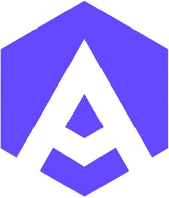
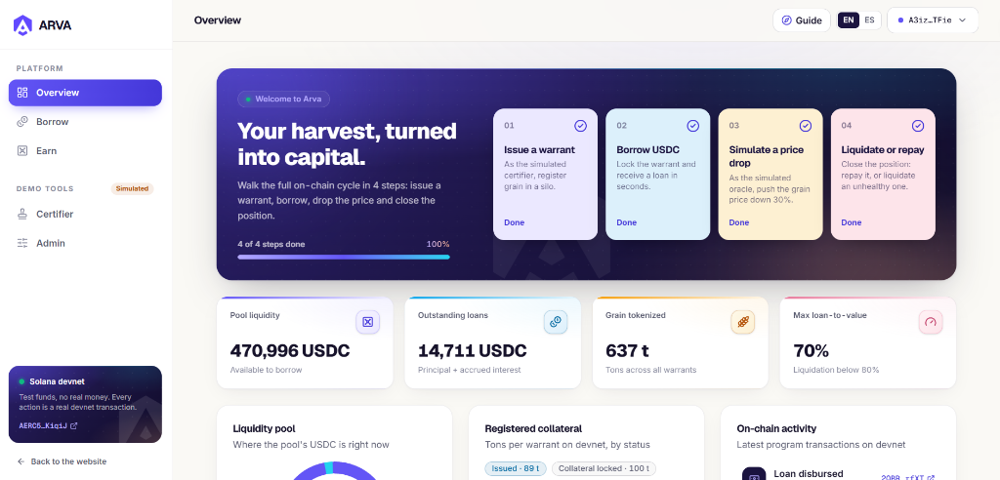

<p align="center">
  <picture>
    <source media="(prefers-color-scheme: dark)" srcset="docs/img/arva-mark-white.png" />
    
  </picture>
</p>

<h1 align="center">ARVA</h1>

<p align="center">
  <b>Open credit for digital grain warrants, on Solana.</b><br/>
  A producer locks a tokenized grain warrant as collateral and receives USDC in seconds from an open liquidity pool, without selling the harvest.
</p>

<p align="center">
  
  
  
  
  
</p>

<p align="center">
  <a href="https://arva-devnet.vercel.app"><b>Live app (devnet)</b></a> ·
  <a href="https://explorer.solana.com/address/AERC53ZiqizgjYdJK9hCeGtSk6PfzwnEn2z3wkMKiqiJ?cluster=devnet"><b>Program on Explorer</b></a> ·
  <a href="docs/SPEC.md"><b>Technical spec</b></a> ·
  <a href="#run-it-locally"><b>Run it</b></a>
</p>

> [!IMPORTANT]
> ARVA runs **only on Solana devnet** (Solana's test network: funds come from a faucet and have no real value). The certifier and the price oracle are **simulated**, and warrant tokens are **test representations** of a warrant, not registered legal titles. The code is **not audited**.

<p align="center">
  <br/>
  <sub>Pool, loans and tokenized tons are read from the deployed program on devnet. Simulated in this MVP: the certifier, the price oracle and the global market view. Test funds only.</sub>
</p>

---

## The harvest exists. The capital doesn't.

Stored grain is a real asset, but an illiquid one. A producer can have 100 tons of soy sitting in a silo bag, roughly USD 35,000 of goods, and still lack working capital for the next season. Seed, fuel and debt are due on the planting calendar, not the selling one.

Argentina already has a legal instrument over that asset: the **warrant**, a credit title that represents stored goods (**Law 9,643**). In practice, using it as collateral is limited to banks and brokers: bilateral deals, manual paperwork and approval times that don't match the season.

**ARVA turns the warrant into programmable collateral.** The warrant is represented on-chain as one token per ton (in this demo, a test token issued by a simulated certifier; linking it to a registry such as A3's is the next milestone). The producer locks it in the program's vault, and an open USDC pool originates the loan. Repay, and the collateral is released. If the grain price breaks the liquidation threshold, anyone can liquidate the position, and the rules are the same for everyone.

> *Because the harvest doesn't wait.*

---

## How it works

```
 Certified warrant  ──►  ARVA program vault  ──►  Open USDC pool
  (1 token = 1 t)        (PDA, no private key)     (anyone can supply)
```

| | Step | What happens on-chain |
|---|---|---|
| 1 | **Certify** | The certifier registers a warrant (silo ID, grain, tons) and mints tokens to the producer. |
| 2 | **Supply** | Anyone deposits USDC into the liquidity pool. |
| 3 | **Borrow** | The producer locks the full warrant and receives **70%** of its value (fixed in this MVP), minus a **0.75%** origination fee. |
| 4 | **Repay** | Principal plus simple interest (accrued per second) is paid back and the tokens are returned. |
| 5 | **Liquidate** | If debt exceeds **80%** of the collateral value, anyone can liquidate: the warrant tokens move from the vault to the pool treasury, and the liquidator earns **5%** of them as a bonus. |

**Example:** 100 t of soy at 350 USDC/t = 35,000 USDC of collateral → 24,500 USDC loan → **≈ 24,316 USDC** received after the fee. The position becomes liquidatable if soy falls below **306 USDC/t**.

---

## Why on-chain

- **Programmable collateral.** It locks itself, releases itself on repayment, and once a loan is unhealthy anyone can liquidate it under rules enforced by code, not by a court.
- **Public audit trail.** Every loan, repayment and liquidation is a transaction anyone can inspect.
- **No custodian.** The collateral sits in a program-derived vault with no private key.
- **Seconds and cents.** Solana's speed and fees make lending to a small producer viable.

---

## The market

- **The instrument is legal and modernized.** Law 9,643, updated by **DNU 70/2023**, enabled electronic warrants, lot splitting and the producer as depositary.
- **It's growing.** Warrants worth **US$2,079M were issued in 2025, +93% year over year** (Secretaría de Agricultura, via Bichos de Campo).
- **Digitization has started.** A3 Mercados and Matba Rofex launched digital warrant platforms, and the Bolsa de Comercio del Chaco structured the first promissory note backed by a digital warrant on MAV.
- **The capital exists.** **74.3%** of Argentine investors hold crypto (Nexo, *Future of Digital Wealth* 2026) and stablecoins are **72%** of local crypto activity (EY), yet that money rarely reaches the real economy.

**Where ARVA fits:** ARVA doesn't digitize warrants; A3 and Matba Rofex already do. **ARVA is the credit layer on top**, making a digital warrant borrowable against open capital, not only a bank's.

| | What they do | How ARVA differs |
|---|---|---|
| A3 Mercados / Matba Rofex | Issue and register digital warrants | They are issuance. ARVA can be their liquidity layer |
| Banks and brokers | Lend against warrants, bilaterally | ARVA uses an open pool and public rules |
| Agrotoken, Nera, SiloReal, Origino | Tokenize or monitor grain and silo bags | A different instrument. ARVA works on the legal warrant |

---

## Try it

1. On a desktop browser, install **Phantom** and switch it to **devnet** (Settings → Developer Settings → Testnet mode → Solana devnet).
2. Open **[arva-devnet.vercel.app/app](https://arva-devnet.vercel.app/app)** and connect Phantom.
3. Click **Get kit**: the starter kit sends your wallet devnet SOL for fees, test USDC and a 100 t demo warrant.
4. Go to **Borrow**, review the loan (LTV, fee, liquidation price) and sign it in Phantom.
5. Open the transaction in Solana Explorer, then **Repay** and watch the warrant return to your wallet.

Everything you sign is a real devnet transaction against the deployed program. No real money is involved.

## The app

- **Landing** that explains the product in plain language, for producers and investors alike.
- **Dashboard** with pool liquidity, outstanding debt, tokenized tons, charts and the latest program transactions, each linked to Solana Explorer.
- **Liquidation simulator:** move the grain price and see exactly when a loan becomes liquidatable.
- **Review screen before every signature:** what you give, what you get, the fee and the liquidation price.
- **Risk in plain language:** four tiers (Healthy, Watch, At risk, Liquidatable) plus how far the price can drop.
- **Guided tour** on every screen for first-time users.
- **English and Spanish.**
- **Demo tools, clearly labeled as simulated:** Certifier (issue warrants) and Admin (move the grain price).

### Real vs. simulated

| ✅ Real (on devnet) | 🧪 Simulated |
|---|---|
| The program, accounts, signatures and public record | The certifier (in production, a licensed warehouse) |
| The collateral vault, repayment and permissionless liquidation | The price oracle (in production, a market feed) |
| SPL warrant tokens and the USDC liquidity pool | What the tokens represent: test warrants, not registered titles |
| | USDC is a test token; the pool is funded by the team |
| | The "global market" view in the app is a labeled simulation; the "Real · devnet" toggle and "Your activity" read the program |

---

## Security and known limitations

What the program enforces:

- **Custody without keys.** Collateral sits in an ATA owned by the `["warrant_vault", warrant]` PDA; only the program can move it.
- **Full collateral.** `borrow` sizes the loan on `warrant.tons` and requires the borrower to lock exactly that many tokens (`CollateralMismatch` otherwise).
- **Permissionless liquidation.** When `value × 80% < debt`, anyone can call `liquidate`: the collateral moves to the pool treasury (an ATA of the `["pool_vault"]` PDA) and the caller earns a 5% bonus. A loan can only be liquidated once.
- **Price circuit breaker.** Each `set_price` update can at most halve or double the current price (`PriceChangeTooLarge`).
- **Checked math.** All amounts are integers with `u128` intermediates and checked operations.

Known limitations of this MVP (not hidden, on the roadmap):

- **Single price authority.** The admin key sets the price. There is no maximum price age, on purpose: reviewers can try the app at any time without someone refreshing the demo oracle.
- **Seized collateral stays in the pool treasury.** There is no auction or sale instruction yet to turn it back into USDC.
- **Lender side.** Deposits mint no shares and can't be withdrawn; interest and fees accrue to the pool as a whole.
- **Fixed 70% LTV.** The borrower can't choose a smaller loan yet.
- **Classic SPL Token.** The warrant token isn't frozen while pledged (it's held in custody instead); Token-2022 is planned.
- **Admin keys are single-signer** and the code is **not audited**.

---

## Roadmap

1. **Validate with the industry:** producers, grain elevators, licensed warehouses and the digital warrant platforms.
2. **Real certification:** a licensed warehouse signs issuance, following the Chaco precedent, and the token links to the registered warrant.
3. **Real prices:** a dedicated price authority separate from the admin, a maximum price age, and a quote from the warrant market (our own signed publisher or an on-demand feed).
4. **Complete liquidation:** auction or sell seized warrants back into USDC for the pool.
5. **Lender side:** LP shares on deposit, `withdraw_liquidity`, and a protocol fee routed to a treasury.
6. **Encumbrance on-chain:** Token-2022 warrant mint frozen by default, and admin, certifier and price authorities under a Squads multisig.
7. **Plug into existing rails:** act as the open liquidity layer for A3 and Matba Rofex digital warrants.
8. **Legal review and audit** before any use with real money: the token-warrant link, the open pool (CNV, VASP registration), the lender of record and how a warrant is enforced after liquidation.

---

## Built with

| Layer | Stack |
|---|---|
| On-chain program | Anchor 1.1.2 + SPL Token (classic), a single program |
| Tests | Rust + LiteSVM (`cargo test`), 18 tests covering instructions and negative cases |
| Frontend | Next.js 16 + TypeScript + Tailwind + Solana Wallet Adapter (Phantom) |
| Scripts | TypeScript (devnet setup, full cycle, inspection) |

**Instructions:** `initialize` · `set_price` · `register_warrant` · `deposit_liquidity` · `borrow` · `repay` · `liquidate`

**Program ID (devnet):** [`AERC53ZiqizgjYdJK9hCeGtSk6PfzwnEn2z3wkMKiqiJ`](https://explorer.solana.com/address/AERC53ZiqizgjYdJK9hCeGtSk6PfzwnEn2z3wkMKiqiJ?cluster=devnet)<br/>
**Test USDC mint:** `12KPRGKraqyydu8favsGtMGqqm23YUEwgc3TVHGwjuef`<br/>
**Last program upgrade (Oct 12, 2026):** [`45V3VdBn…VrZMVQW`](https://explorer.solana.com/tx/45V3VdBnrb5avd1bWXV219sU4EszG6jAJvh8wqHBmpRGtDagAKAVNWSoMsf3Z3DXoMCmWmHc4VavMEghBVrZMVQW?cluster=devnet) (full-collateral check, collateral transfer on liquidation, price circuit breaker). Liquidation verified on devnet: [`5AHY9qn3…3Mmh1RMU`](https://explorer.solana.com/tx/5AHY9qn39u6W4mAaqoT1cisausbj6Lg5SGidZHpxYADXBCUxN9iupFDPi6kFBaw9wSzdfN57ZFHiMGpU3Mmh1RMU?cluster=devnet)

```
programs/arva/   Anchor program (src/, tests/)
app/              Next.js frontend (landing at public/index.html, app at /app)
scripts/          Devnet scripts (TS)
docs/SPEC.md      Technical contract (takes precedence over code)
docs/DESIGN.md    UI design brief
docs/img/         Screenshots and brand assets
```

<a id="run-it-locally"></a>
### Run it locally

```bash
# Program
anchor build
cargo test
anchor deploy --provider.cluster devnet

# Frontend → http://localhost:3000
cd app
npm install
NEXT_PUBLIC_USE_REAL=true npm run dev
```

- `NEXT_PUBLIC_USE_REAL=true` reads and writes on devnet; without it, the app uses in-memory mock data.
- `NEXT_PUBLIC_RPC_URL` overrides the RPC (default `https://api.devnet.solana.com`).
- You need **Phantom set to devnet** to sign transactions.

---

## Project rules

- **Devnet only.** Never mainnet, never real funds.
- **No keys or secrets** in the repository.
- **Every transaction requires the user's explicit signature.**

## Team

Solo founder: **Alejandro** ([@alejandrocol-dev](https://github.com/alejandrocol-dev)), Information Systems Engineering student in Tucumán, Argentina. Product, Anchor program, app and deployment.

## Progress and disclosures

- **Starting point:** nothing existed before the competition. The idea was chosen on Oct 3, 2026 and the first commit is from Oct 4, 2026. No prior code, users, revenue or funding.
- **Changelog** (full history in the git log):
  - **Oct 4:** Anchor program (7 instructions), LiteSVM tests, devnet deployment and first version of the app.
  - **Oct 6 to 9:** new landing and app design, guided tour, real on-chain data in the UI, liquidation simulator.
  - **Oct 11:** rename to ARVA, new brand, judge starter kit (SOL, test USDC and a demo warrant from one click) and guided journey.
  - **Oct 12:** personal activity trail, labeled simulated market view, mobile landing; after the Superteam Argentina review: full-collateral check in `borrow`, collateral transfer and liquidator bonus in `liquidate`, price circuit breaker, corrected claims.
- **Third-party components:** Anchor, SPL Token, Solana Wallet Adapter, Next.js, Tailwind CSS and their open-source dependencies.

## Use of AI

Material use of AI: built with Devin (Cognition) as a coding assistant, which generated most of the code for the program, tests, app and scripts, and helped with research and copy drafts. The idea, product decisions, specifications and review are the author's; generated code was reviewed and tested before each commit.

<p align="center"><sub>ARVA · built on Solana · devnet · not audited</sub></p>
